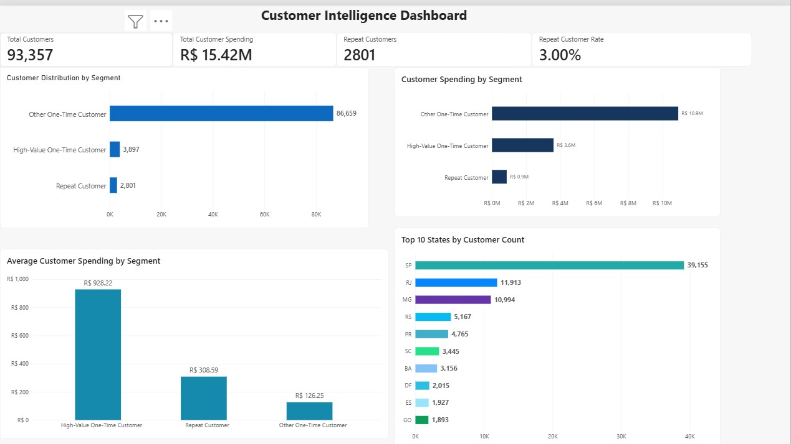
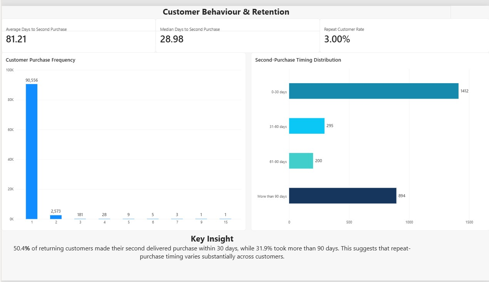
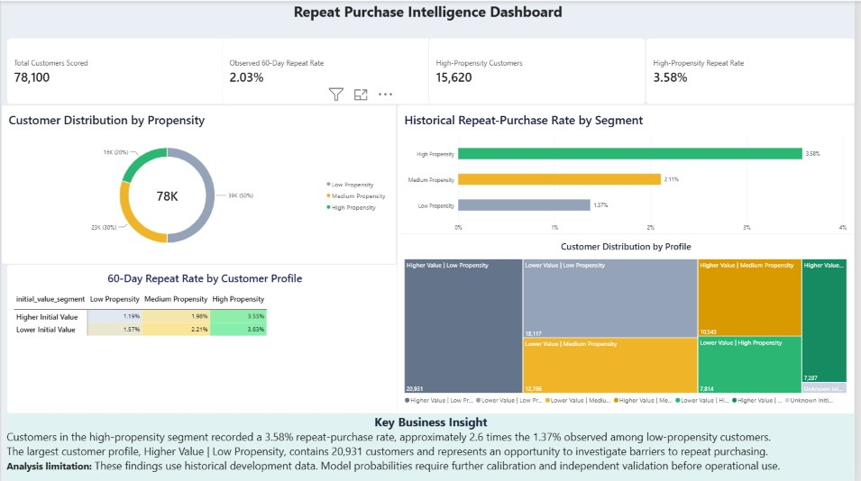

 
# Customer Intelligence Platform

An end-to-end data science and business intelligence project using the Brazilian Olist e-commerce dataset to understand customer purchasing behaviour, evaluate 60-day repeat-purchase propensity, analyse observed merchandise value, and support evidence-based retention decisions.

The platform combines **SQL, PostgreSQL, Python, machine learning, and Power BI** across **12 Jupyter notebooks**, reproducible feature-engineering and scoring scripts, and four interactive dashboard pages.

> **Project status:** Historical customer intelligence analysis complete. The platform is an analytical and decision-support prototype, **not** a production-ready automated targeting system. Prospective model validation and evidence of incremental commercial impact are still required.

## 1. Project Overview

### Business problem

Customers differ in their initial purchasing value and likelihood of buying again. A business needs to understand those differences without assuming that high spending implies loyalty, that predicted repeat-purchase propensity represents monetary value, or that a customer segment will respond positively to a marketing intervention.

This project addresses five questions:

1. What is the historical baseline for customer purchasing and 60-day repeat purchasing?
2. How do repeat-purchase behaviour and observed merchandise value differ across customer groups?
3. What can be learned by considering initial purchase value and repeat-purchase propensity together?
4. Which business recommendations are supported by the available evidence?
5. What additional validation and experiments are needed before operational deployment?

### Results at a glance

| Historical reporting metric | Result |
|---|---:|
| Customers | 78,100 |
| Customers with a qualifying repeat purchase within 60 days | 1,589 |
| Observed 60-day repeat-purchase rate | 2.03% |
| Initial delivered merchandise value | R$10,395,105.68 |
| Subsequent 60-day merchandise value | R$211,295.19 |
| Combined observed merchandise value | R$10,606,400.87 |
| Higher Value \| Low Propensity customers | 20,931 |

**Interpretation:** The immediate opportunity is trusted customer reporting, targeted investigation, and rigorous experiment planning. These historical results do not establish causal treatment effects, customer lifetime value, or profitability.

### Delivery status

**Completed:** Data preparation and SQL analysis; customer-level feature engineering; repeat-purchase modelling and evaluation; historical propensity segmentation; model reliability analysis; historical merchandise-value analysis; experimental monetary-value modelling; integrated customer intelligence reporting; four Power BI pages; and evidence-based recommendations with experiment feasibility assessment.

**Not yet approved:** Automated propensity-based targeting, deployment of predicted monetary customer value, or claims that retention campaigns generate incremental revenue or profit.

## 2. Project Architecture and Repository Structure

The analytical flow is: **Olist transaction data → PostgreSQL and Python preparation → customer features → model evaluation and historical scoring → customer/value integration → Power BI reporting → business recommendations.**

```text
customer-intelligence-platform/
├── data/
│   └── processed/
├── images/
│   ├── customer_overview.jpg
│   ├── customer_behaviour_retention.jpg
│   ├── repeat_purchase_intelligence.jpg
│   └── Customer Value & Decision Intelligence.jpg
├── models/
│   └── repeat_purchase_logistic_regression.joblib
├── notebooks/
│   └── [12 analytical Jupyter notebooks]
├── powerbi/
│   └── powerbi.pbix
├── scripts/
│   ├── build_customer_features.py
│   └── score_customers.py
├── sql/
│   ├── 01_create_customer_table.sql
│   ├── 02_create_remaining_tables.sql
│   ├── 03_customer_spending.sql
│   ├── 04_customer_segmentation.sql
│   ├── 05_data_validation.sql
│   └── 06_second_purchase_analysis.sql
├── .gitignore
├── README.md
└── requirements.txt
```

The tree shows the main project components rather than every dataset, model artefact, or notebook filename. Some processed datasets are local inputs or outputs and may need to be supplied or generated separately.

## 3. Analytical Workflow

The work was developed across 12 notebooks in the following sequence:

| Notebook | Analytical stage | Purpose |
|---|---|---|
| 01 | Exploratory Data Analysis | Investigate transactions, purchasing patterns, and data quality. |
| 02 | Customer Feature Engineering | Build customer-level features and define the 60-day repeat-purchase target. |
| 03 | Repeat-Purchase Modelling | Develop predictive models using chronological training, validation, and test populations. |
| 04 | Model Evaluation and Insights | Evaluate discrimination, probability reliability, and performance against baselines. |
| 05 | Model Explainability | Examine model drivers and their relationship with predictions. |
| 06 | Model Improvement | Investigate alternative modelling approaches and performance improvements. |
| 07 | Customer Scoring and Segmentation | Generate propensity groups and examine historical repeat-purchase behaviour. |
| 08 | Model Reliability and Validation | Investigate temporal stability, evaluation populations, and reliability limitations. |
| 09 | Historical Customer Value Analysis | Measure observed initial and subsequent merchandise value. |
| 10 | Predictive Customer Value | Explore experimental approaches to monetary-value prediction. |
| 11 | Customer Value Integration | Integrate customer outcomes, propensity segments, and historical merchandise value. |
| 12 | Business Insights and Recommendations | Develop business hypotheses, experiment feasibility assessments, and decisions. |

**Analytical outcome:** A reproducible foundation for historical customer intelligence and evidence-based retention planning. Predictive models still require genuinely prospective validation before operational use; experimental monetary-value predictions remain outside approved production reporting.

## 4. Technical Implementation and Reproducibility

### 4.1 Data engineering and SQL

- Established the repository, Git version control, and PostgreSQL data environment.
- Imported and validated the Olist e-commerce dataset.
- Developed SQL analyses of customer spending, segmentation, purchasing frequency, repeat-purchase behaviour, and second-purchase timing.
- Preserved the existing Olist database tables during customer intelligence integration.

### 4.2 Customer feature engineering

The feature-engineering workflow uses historical transactions to derive first-order spending, product-category, basket, payment, freight, purchase-timing, and geographic features. It defines a 60-day repeat-purchase target with an observation window and eligibility rules, including a 30-day delivery buffer to avoid uncertain negative labels.

The standalone script is [`scripts/build_customer_features.py`](scripts/build_customer_features.py).

**Build mode:** Generate customer features from the original Olist inputs without requiring the saved reference dataset.

```powershell
python scripts/build_customer_features.py --mode build
```

Output: `data/processed/customer_features_built.pkl`

**Verify mode:** Reconstruct customer features and compare identifiers, columns, and values with the validated reference dataset before exporting the verified result.

```powershell
python scripts/build_customer_features.py --mode verify
```

Output: `data/processed/customer_features_rebuilt.pkl`

Verify mode requires `data/processed/customer_features_reference.pkl`. If no mode is specified, the script defaults to `verify`.

**Inputs and dependencies:** Original Olist CSV files in `data/`, plus the Python packages in [`requirements.txt`](requirements.txt). The saved reference dataset is additionally required for **verify mode** and must be supplied separately if absent from the repository.

**Recorded verification results:**

| Validation metric | Result |
|---|---:|
| Customer records | 78,100 |
| Dataset columns | 29 |
| Confirmed repeat purchasers | 1,589 |
| Duplicate customers | 0 |
| Missing or extra customers | 0 |
| Columns with value differences | 0 |

The comparison aligns customers by identifier and uses a numerical tolerance for floating-point fields. The original validated feature dataset is not overwritten.

### 4.3 Predictive modelling and reliability

- Developed a logistic regression baseline for 60-day repeat-purchase prediction.
- Explored Random Forest and XGBoost alternatives.
- Evaluated ROC-AUC, average precision, Brier score, and log loss using chronological validation and holdout analysis.
- Examined model drivers, missing-value handling, regularisation, temporal stability, and probability calibration.
- Identified calibration and generalisation limitations that prevent an operational targeting recommendation at this stage.

Historical development and evaluation populations have been examined during the project. They are **not** a substitute for a genuinely new prospective evaluation.

### 4.4 Historical customer scoring and segmentation

The historical reporting dataset includes **78,100 customers**. A separate reproducible scoring pipeline, [`scripts/score_customers.py`](scripts/score_customers.py), uses a saved fitted logistic regression pipeline and its expected nine model features to generate historical 60-day repeat-purchase propensity scores.

From the project root:

```powershell
python scripts/build_customer_features.py --mode build
python scripts/score_customers.py
```

**Required scoring inputs:** `data/processed/customer_features_built.pkl`, `models/repeat_purchase_logistic_regression.joblib`, and the dependencies in `requirements.txt`.

| Reproducible scoring metric | Result |
|---|---:|
| Historical customers | 78,100 |
| Successfully scored | 76,197 |
| Unscored because model inputs were missing | 1,903 |
| Missing probabilities among scored customers | 0 |
| Duplicate customer identifiers | 0 |

Output: `data/processed/customer_scoring_output.pkl`, containing `customer_unique_id`, `order_id`, `repeat_purchase_propensity`, and `scoring_status`.

Customers with incomplete model inputs are retained with an explicit unscored status; no default propensity is assigned. The script checks scoring coverage, identifier uniqueness, probability ranges, and saved output integrity.

**Important distinction:** The existing Power BI propensity dashboard reports a **historical segmentation population of 78,100 customers**, including **15,620** in its high-propensity group. The separate reproducible pipeline scores **76,197 customers**, with **15,240** classified as high propensity in that output. These are different historical analytical outputs and must not be presented as the same scoring run. Re-running the scoring script does not retrain or independently validate the model.

### 4.5 Customer value integration and PostgreSQL

- Combined initial purchase value and propensity into seven customer profiles, including an **Unknown Initial Value** group.
- Integrated observed initial and subsequent 60-day merchandise value with historical customer behaviour and propensity segments.
- Exported customer intelligence datasets in CSV and Parquet formats.
- Loaded **78,100** customer records into the PostgreSQL table `customer_intelligence_v2` and checked record counts, uniqueness, and segmentation metrics.

**Value definitions matter:** Recorded first-order basket value, initial **delivered** merchandise value, subsequent 60-day merchandise value, and predicted repeat-purchase propensity measure different things. Observed merchandise value is not profit, contribution margin, or customer lifetime value. Experimental predicted monetary value is not included as an approved operational measure.

## 5. Power BI Dashboards

The project includes **four interactive Power BI dashboard pages**. Screenshots provide a preview for readers without Power BI Desktop. The report file is [`powerbi/powerbi.pbix`](powerbi/powerbi.pbix).

### 5.1 Customer Overview



**Purpose:** Summarise the customer base, spending patterns, and geographic distribution.

**Visuals:** KPI cards for customer and purchasing measures; customer distribution, total spending, and average spending by segment; and the top 10 states by customer population.

**Business interpretation:** Distinguishes customer volume from spending contribution and highlights customer groups and geographic markets for further investigation.

### 5.2 Customer Behaviour & Retention



**Purpose:** Explore historical one-time and repeat purchasing, second-purchase timing, and retention patterns across relevant customer groups.

**Business interpretation:** Helps formulate questions and potential retention experiments. Descriptive differences alone do not demonstrate the effect of a campaign.

### 5.3 Repeat-Purchase Intelligence



**Purpose:** Compare historical propensity segments, customer profiles, and observed repeat-purchase behaviour.

The historical dashboard reports **78,100 customers**, **15,620 high-propensity customers**, and an overall observed 60-day repeat-purchase rate of **2.03%**. The high-propensity segment's observed repeat rate is **3.58%**, compared with **1.37%** and **2.11%** for the low- and medium-propensity groups respectively.

**Visuals:** Propensity distribution, historical repeat-purchase rates, customer profile heatmap, and customer distribution by profile.

**Important limitation:** This is a historical descriptive view that includes model development data. Segment differences do not constitute independent predictive validation or evidence of incremental treatment responsiveness. These historical dashboard counts should not be conflated with the separate reproducible scoring output in Section 4.4.

### 5.4 Customer Value & Decision Intelligence


**Purpose:** Combine purchasing behaviour, repeat-purchase propensity, and observed merchandise value to support evidence-based business decisions.

**What it supports:** Comparison of customer value across groups; joint assessment of initial spending and propensity; identification of groups requiring investigation; and clear separation of observed historical value from predicted future value.

**Important limitation:** Merchandise value is not profit or customer lifetime value. Differences between historical groups do not establish the incremental impact of retention campaigns.

## 6. Key Business Findings

### 6.1 Historical repeat purchasing is limited

Among **78,100** customers, **1,589** made a qualifying repeat purchase within 60 days, producing an observed repeat-purchase rate of **2.03%**. This is a measurable historical baseline, not an explanation of why customers return.

### 6.2 Higher initial value does not guarantee repeat purchasing

The **Higher Value | Low Propensity** profile contains **20,931 customers (26.80%)**, with a **1.19%** observed 60-day repeat-purchase rate and **R$264.28** average observed merchandise value per customer. It is the largest customer profile and warrants investigation of purchase categories, experience, delivery outcomes, and repurchase intervals.

**Implication:** Prioritise discovery, not automatic campaign deployment. Historical spending does not establish customer profitability or likely response to intervention.

### 6.3 Propensity and observed merchandise value are distinct

The **Higher Value | High Propensity** profile contains **7,287 customers**, with a **3.55%** observed repeat-purchase rate, **R$175.70** average observed merchandise value, and **R$5.58** average subsequent 60-day merchandise value per customer.

These measures should be considered together, not treated as interchangeable predictions of future customer value.

### 6.4 Observed merchandise value is not profitability

The reporting population recorded **R$10,395,105.68** in initial delivered merchandise value and **R$211,295.19** in subsequent 60-day merchandise value, for **R$10,606,400.87** combined. Subsequent merchandise accounts for approximately **1.99%** of the combined amount.

These figures are neither customer lifetime value nor incremental revenue attributable to marketing. Contribution margin and intervention costs would be needed for a commercial investment decision.

### 6.5 Detecting modest retention improvements may require large experiments

Using the historical **1.19%** repeat-purchase baseline for Higher Value | Low Propensity customers, a two-sided test with **5% significance**, **80% power**, and **equal treatment/control allocation** gives the following illustrative sample sizes:

| Assumed relative improvement | Total customers required |
|---|---:|
| 10% | 273,492 |
| 20% | 71,480 |
| 30% | 33,120 |
| 50% | 12,870 |

These are **hypothetical planning scenarios**, not forecasts of achievable uplift. The historical profile of 20,931 customers is smaller than the calculated samples for 10%, 20%, and 30% relative improvements, but historical segment size does **not** establish future eligible recruitment volume.

**Implication:** Establish prospective eligibility, recruitment rate, a minimum commercially meaningful effect, intervention cost, contribution margin, and model readiness before approving an effectiveness experiment. A small operational pilot can assess delivery and customer experience but should not be interpreted as evidence of incremental impact if underpowered.

## 7. Business Recommendations and Decision Framework

| Proposed action | Decision | Evidence or action required next |
|---|---|---|
| Establish a consistent customer performance scorecard | **Proceed** | Reporting quality assurance and stakeholder sign-off |
| Investigate higher-value, low-propensity customers | **Prioritise discovery** | Behavioural and customer-experience evidence |
| Test whether targeted engagement creates incremental value | **Conditional** | Eligible recruitment, commercial assumptions, and sufficient statistical power |
| Deploy automated propensity-based targeting | **Not yet approved** | Prospective model, feature, and operational validation |
| Deploy predicted monetary customer value | **Not yet approved** | Independent predictive and commercial validation |
| Preserve transparent customer and merchandise-value definitions | **Proceed** | Ongoing data-quality monitoring |

### Recommended experiment, subject to feasibility approval

**Hypothesis:** Timely post-purchase engagement increases the proportion of eligible customers making a second delivered purchase within 60 days.

**Design:** Randomise eligible customers at the customer level between an engagement treatment and the existing experience. Classify customers using only features available **before** intervention; follow both groups for 60 days and analyse by assigned group.

**Primary metric:** Incremental delivered 60-day repeat-purchase rate.

**Commercial measures:** Incremental subsequent merchandise value per assigned customer, contribution margin after intervention costs, and cost per incremental repeat purchaser.

**Guardrails:** Unsubscribes, complaints, communication frequency, refunds, returns, promotion costs, and data quality.

**Approval condition:** Do not launch an effectiveness test until recruitment capacity, commercial value, operational eligibility, and measurement feasibility are established. There are currently no treatment/control results demonstrating uplift.

### Final business decision

**Proceed with descriptive customer reporting and focused investigation. Do not proceed directly to large-scale propensity-targeted retention campaigns.** The evidence supports experiment planning, but not an incremental revenue or profitability claim.

## 8. Limitations and Operational Readiness

- **Historical rather than prospective evidence:** Some customers in the integrated reporting and segmentation analysis were also used during model development and evaluation.
- **Model reliability:** Probability calibration, temporal stability, generalisation, and discrimination require further validation on genuinely future cohorts.
- **Decision-time features:** Inputs must be confirmed as available before any marketing intervention to avoid leakage.
- **Incomplete scoring coverage:** The standalone scoring pipeline leaves 1,903 customers explicitly unscored because required model inputs are missing.
- **Different analytical populations:** Historical Power BI segmentation and reproducible scoring outputs have different coverage and segment counts; they must remain clearly labelled.
- **Observed value versus commercial return:** Merchandise value excludes the contribution-margin and intervention-cost information needed for profitability decisions.
- **No causal evidence:** Historical differences across propensity/value groups cannot demonstrate incremental treatment responsiveness.
- **Experiment feasibility:** The low baseline repeat-purchase rate creates a substantial sample-size and recruitment challenge.

**Readiness assessment:** The project is complete as a historical analytical portfolio and decision-support prototype. It is not yet suitable for automated operational targeting or production monetary-value predictions.

## 9. Future Validation and Production Roadmap

### Predictive model validation

- Evaluate discrimination and probability calibration on genuinely new, future customer cohorts.
- Monitor performance and stability by time period and relevant customer groups.
- Verify feature availability and investigate potential leakage at the intended decision point.
- Compare model-driven decisions with appropriate business benchmarks.

### Monetary value and commercial validation

- Independently validate experimental monetary-value predictions against future outcomes and business benchmarks.
- Establish contribution-margin, acquisition-cost, and intervention-cost measures.
- Introduce predicted monetary value into operational reporting only after appropriate validation.
- Continue distinguishing observed merchandise value from profit and customer lifetime value.

### Retention experiments and reporting

- Investigate reasons for low repeat purchasing among high-initial-value customers.
- Estimate the prospective flow of eligible customers and define commercially meaningful effects.
- Design and evaluate controlled interventions where sample size and recruitment permit.
- Improve Power BI navigation and add appropriately validated longitudinal business metrics.

### Platform engineering

- Improve automation, testing, data-quality checks, dependency management, and monitoring.
- Explore Docker containerisation and GitHub Actions for repeatable workflows.

## 10. Technologies Used

| Area | Technologies |
|---|---|
| Programming and analysis | Python, Pandas, NumPy, SQL |
| Database and data engineering | PostgreSQL 17, SQLAlchemy, psycopg2, Parquet, CSV |
| Machine learning | Scikit-learn, XGBoost, Joblib |
| Visualisation and reporting | Power BI Desktop, Matplotlib, Seaborn |
| Development and version control | Visual Studio Code, Jupyter Notebooks, Git, GitHub |
| Future development | Docker, GitHub Actions, model monitoring |

## Author

**Esther A**
