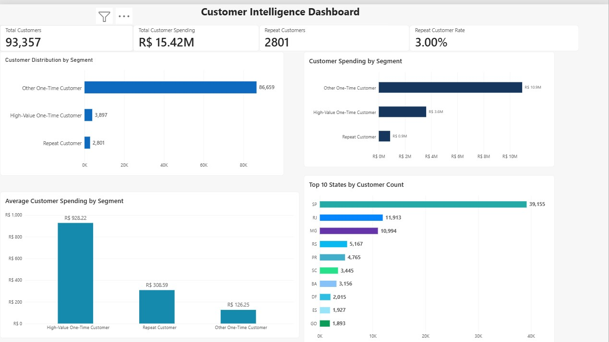
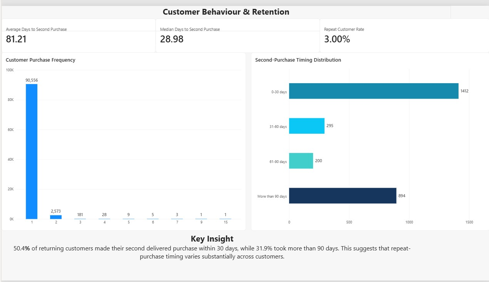
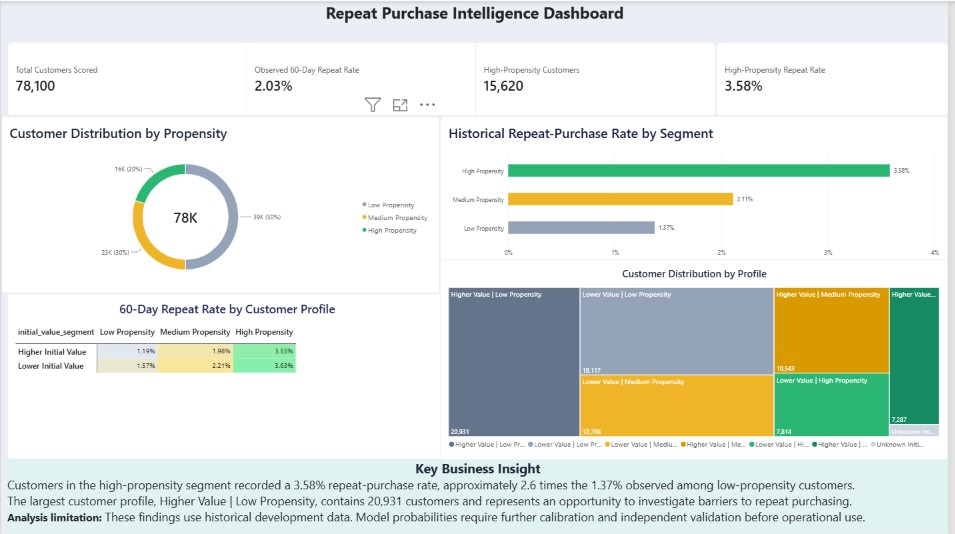

# Customer Intelligence Platform

## Project Overview

This project is an end-to-end Customer Intelligence Platform developed using the Brazilian Olist e-commerce dataset. It combines PostgreSQL, SQL, and Power BI to analyse customer purchasing behaviour, spending patterns, segmentation, and repeat purchases.

The objective is to transform raw transactional data into meaningful business insights that support customer understanding, retention analysis, and data-driven decision-making.

The current implementation includes relational database development, SQL-based data transformation and validation, customer segmentation, second-purchase behaviour analysis, and a two-page interactive Power BI dashboard. Future development will explore Python-based analytics and predictive machine learning.
---

## Project Structure

```
customer-intelligence-platform/
│
├── data/
│   └── processed/
│
├── notebooks/
│
├── powerbi/
│   └── powerbi.pbix
│
├── scripts/
│
├── sql/
│   ├── 01_create_customer_table.sql
│   ├── 02_create_remaining_tables.sql
│   ├── 03_customer_spending.sql
│   ├── 04_customer_segmentation.sql
│   ├── 05_data_validation.sql
│   └── 06_second_purchase_analysis.sql
│
├── .gitignore
├── README.md
└── requirements.txt
```

## Power BI Dashboard Preview

### Customer Overview

## Power BI Dashboard Preview

The Customer Intelligence Platform includes three interactive Power BI dashboards that transform e-commerce transaction data into customer insights. Together, they support customer understanding, repeat-purchase analysis and exploratory retention decision-making.

### Customer Overview



**Purpose:** Provide an overview of the customer base, spending patterns and geographic distribution.

**What the visuals show:**

- **KPI cards:** Summarise total customers, customer spending, repeat customers and repeat-purchase rate.
- **Customer distribution by segment:** Shows the relative size of repeat, high-value one-time and other one-time customer groups.
- **Customer spending by segment:** Compares the total spending contributed by each customer segment.
- **Average spending by segment:** Highlights differences in spending behaviour across customer groups.
- **Top 10 states:** Identifies the geographic markets with the largest customer populations.

**Business interpretation:** The dashboard helps distinguish customer volume from customer value, identify where spending is concentrated and highlight customer groups that deserve further investigation.

### Customer Behaviour & Retention



**Purpose:** Explore historical purchasing behaviour and the factors associated with customers returning to purchase again.

**What the dashboard helps investigate:**

- Differences between one-time and repeat purchasers.
- The timing of subsequent purchases and repeat-purchase behaviour.
- Customer retention patterns across relevant segments.
- Potential opportunities for more focused retention analysis.

**Business interpretation:** Understanding when customers return and how purchasing behaviour differs can help businesses formulate targeted retention experiments rather than relying on broad, untargeted campaigns.

### Repeat-Purchase Intelligence Dashboard



**Purpose:** Combine predictive modelling with historical purchasing behaviour to identify customer groups with different relative likelihoods of repeat purchasing within 60 days.

**What the visuals show:**

- **KPI cards:** Summarise 78,100 historical customers scored, a 2.03% observed 60-day repeat-purchase rate, 15,620 high-propensity customers and a 3.58% repeat rate within the high-propensity segment.
- **Customer distribution by propensity:** Shows how customers are divided into low (50%), medium (30%) and high (20%) propensity groups.
- **Historical repeat-purchase rate by segment:** Compares observed repeat rates of 1.37%, 2.11% and 3.58% across low-, medium- and high-propensity customers.
- **Customer profile heatmap:** Compares observed repeat-purchase rates across initial spending groups and propensity segments.
- **Customer distribution by profile:** Shows where customer volume is concentrated across combinations of initial spending and propensity.

**Key business findings:**

The high-propensity segment recorded approximately 2.6 times the historical repeat-purchase rate of the low-propensity segment.

The largest customer profile, **Higher Value | Low Propensity**, contains 20,931 customers. This group offers an opportunity to investigate barriers to repeat purchasing, although higher initial spending does not necessarily mean higher lifetime value or profitability.

**Potential business application:** These insights could help prioritise customer research, design controlled retention experiments and evaluate different engagement strategies.

**Important limitations:** The results use historical development data, including customers used during model training. The observed segment differences are descriptive rather than independent validation. Model probabilities also require improved calibration and further testing before being used for operational customer targeting.

---

### Dashboard Access

The interactive Power BI report is available in [`powerbi/powerbi.pbix`](powerbi/powerbi.pbix). The screenshots above provide a visual preview for reviewers who do not have Power BI Desktop installed.

---


## Current Progress

-## Current Progress

### Data Engineering & SQL
- Established the project structure, Git version control and GitHub repository.
- Imported and validated the Olist e-commerce dataset in PostgreSQL.
- Developed SQL analyses covering customer spending, segmentation, purchasing frequency and repeat-purchase behaviour.
- Analysed second-purchase timing, including average and median days between purchases.

### Customer Feature Engineering
- Built a customer-level feature engineering workflow using historical transaction data.
- Developed customer attributes covering first-order spending, product categories, basket composition, purchase timing and geographic location.
- Created a 60-day repeat-purchase target with a defined observation window and eligibility criteria.
- Prepared 78,100 historical customers for scoring and segmentation.

### Predictive Modelling & Evaluation
- Developed a logistic regression baseline for predicting repeat purchases within 60 days.
- Evaluated alternative approaches, including Random Forest and XGBoost.
- Compared model performance using ROC-AUC, average precision, Brier score and log loss.
- Conducted chronological validation and holdout evaluation.
- Analysed model drivers and explored improvements to missing-value handling and regularisation.
- Identified limitations in model calibration and generalisation that must be addressed before production deployment.

### Customer Intelligence & Segmentation
- Generated repeat-purchase propensity scores for 78,100 historical customers.
- Developed low-, medium- and high-propensity customer segments.
- Combined initial order spending and propensity to create seven customer profiles, including an unknown-value group.
- Compared observed repeat-purchase behaviour across customer segments.
- Exported validated customer intelligence datasets in CSV and Parquet formats.

### PostgreSQL Integration
- Developed a reusable Python script to load customer intelligence outputs into PostgreSQL.
- Successfully loaded 78,100 customer records into `customer_intelligence_v2`.
- Validated record counts, customer uniqueness and propensity-segment metrics using SQL.
- Preserved the existing Olist database tables.

### Power BI & Business Intelligence
- Developed three Power BI dashboard pages:
  - **Customer Overview:** Customer base, spending patterns, segmentation and geographic distribution.
  - **Customer Behaviour & Retention:** Historical purchasing behaviour and repeat-purchase analysis.
  - **Repeat-Purchase Intelligence:** Propensity segments, customer profiles, observed repeat rates and business insights.
- Integrated the historical customer intelligence dataset directly from PostgreSQL.
- Added interactive reporting, KPIs, customer profile comparisons and a repeat-purchase heatmap.
- Documented business implications and model limitations.

### Current Status
**Historical customer intelligence prototype completed.**

The platform now connects SQL analysis, Python feature engineering, machine learning, PostgreSQL and Power BI into a reproducible analytical workflow.

The next phase focuses on independent model validation, calibration, reproducibility improvements and evaluating customer targeting strategies through controlled experiments.

---

## Next Development Stages

### Model Reliability & Validation
- Improve probability calibration to ensure predicted repeat-purchase likelihoods better reflect observed outcomes.
- Evaluate model stability across customer cohorts, product categories and purchasing periods.
- Establish stronger out-of-time validation using new, independently held-out data.
- Investigate potential data leakage and confirm feature availability at the intended prediction point.

### Customer Lifetime Value (CLV)
- Develop customer lifetime value estimates using historical purchasing behaviour.
- Identify high-value customer groups beyond their initial order spending.
- Combine customer value and repeat-purchase propensity to support more commercially meaningful segmentation.
- Evaluate the relationship between customer value, retention and profitability where reliable cost data is available.

### Retention Strategy & Decision-Making
- Translate customer segments into testable retention strategies.
- Investigate why customers with higher initial spending may not return.
- Develop hypotheses for personalised customer engagement.
- Design controlled experiments to measure whether targeted interventions improve repeat purchasing.

### Platform Engineering & Reproducibility
- Improve automation of data preparation, feature engineering and customer scoring.
- Introduce automated data quality checks and model monitoring.
- Enhance documentation, dependency management and reproducibility.
- Explore containerisation using Docker and automated testing through GitHub Actions.

### Business Intelligence & Reporting
- Enhance Power BI reporting with customer lifetime value and additional commercial KPIs.
- Improve dashboard navigation, filtering and customer segment comparisons.
- Develop reporting to track model performance and customer behaviour over time.
- Support clearer business recommendations through actionable insights.

### Long-Term Vision

Evolve the Customer Intelligence Platform from a historical analytics and predictive modelling prototype into a reliable customer decision-support system.

The long-term goal is to help businesses understand customer behaviour, estimate future customer value, identify retention opportunities and evaluate personalised engagement strategies through measurable business outcomes.

---

## Technologies Used

### Programming & Data Analysis
- **Python:** Data processing, customer analysis, feature engineering and predictive modelling.
- **Pandas & NumPy:** Data manipulation, transformation and numerical analysis.
- **SQL:** Customer behaviour analysis, segmentation and data validation.

### Database & Data Engineering
- **PostgreSQL 17:** Relational database for storing and analysing customer transactions and intelligence outputs.
- **SQLAlchemy & psycopg2:** Python integration with PostgreSQL.
- **Parquet & CSV:** Data storage and analytical exports.

### Machine Learning
- **Scikit-learn:** Logistic regression, Random Forest, preprocessing, model evaluation and hyperparameter tuning.
- **XGBoost:** Alternative repeat-purchase prediction modelling.
- **Joblib:** Saving and loading trained machine learning models.
- **Model explainability:** Logistic regression feature-contribution analysis.

### Data Visualisation & Business Intelligence
- **Power BI Desktop:** Interactive customer intelligence dashboards and business reporting.
- **Matplotlib:** Exploratory data analysis and model visualisations.
- **Seaborn:** Statistical data visualisation.

### Development & Version Control
- **Visual Studio Code:** Development environment.
- **Jupyter Notebooks:** Exploratory analysis, modelling and evaluation workflows.
- **Git & GitHub:** Version control, documentation and project management.

### Technologies Planned for Future Development
- **Docker:** Containerisation and reproducible environments.
- **GitHub Actions:** Automated testing and continuous integration.
- **Model monitoring:** Performance tracking, data quality monitoring and scoring reliability.

## Author

**Esther A**
